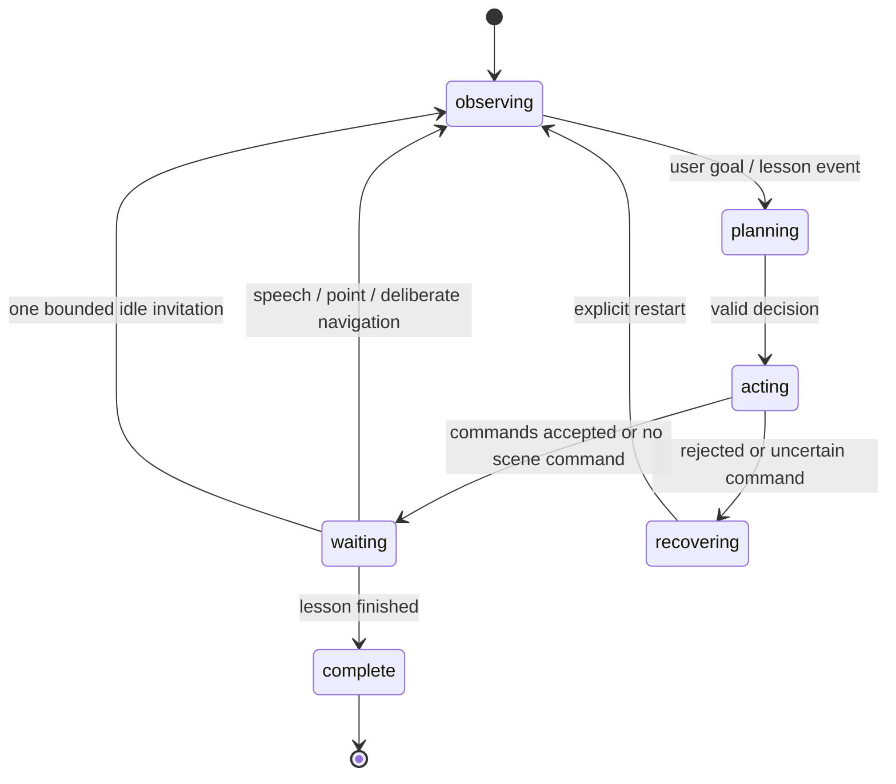

# A small ReAct-style controller for the demo

## Research and decision

[ReAct](https://arxiv.org/abs/2210.03629) interleaves decisions/actions with observations from the environment. For this demo the useful part is an explicit feedback loop, not a long generated reasoning transcript. Keep private model reasoning private; expose only state, selected action and observable result.

[OpenAI's practical guide](https://openai.com/business/guides-and-resources/a-practical-guide-to-building-ai-agents/) recommends starting with a single agent and explicit run exit conditions. [Anthropic's building-effective-agents guide](https://www.anthropic.com/research/building-effective-agents) distinguishes predictable workflows from model-directed agents and recommends adding complexity only when useful. These are architectural principles, not evidence that a framework will improve this demo.

Use the existing Node service and strict model schemas. One agent controls a bounded lesson DAG. Deterministic transitions govern lifecycle; the model plans unsupported spontaneous goals. Do not add a new framework, tool registry, multi-agent runtime, vector store or continuous reasoning loop.

## States and observations

Server decision states and client execution states are distinct. A returned decision is ready to act; only the executor knows whether a command succeeded. Video frame observations are separate again: a command receipt does not prove the intended face or action appeared. The client enters recovery on uncertain commands and never automatically replays them.

## Minimal demo behavior

- **Branch:** a clear new goal creates a short 1–3-node detour and preserves the main checkpoint.
- **Change mind:** a new valid goal replaces future detour nodes while keeping the same return point. An invalid/unavailable replacement leaves the old branch intact.
- **Return:** one explicit return action appends a forward rejoin visit; it does not reset the video or rewind executed visits.
- **Proactivity:** after a quiet period, offer one contextual spoken invitation per node, only while waiting, with visible/live or explicit practice context and no active microphone, speech playback or pending request. Do not choose or purchase an item, advance the lesson or generate video automatically.
- **Bounded work:** one model plan at most per user event, current operation retry budget, bounded detours/history, one proactive invitation per node, and immediate cancellation on Leave/input.

Proactive invitations use a deterministic short clerk/coach line to avoid an extra model call and unpredictable delay. This is bounded initiative inside a hybrid workflow, not a claim of open-ended autonomous planning. Keep the page simple: existing speech controls, a contextual Return to lesson action, and compact status. Put technical state traces in the existing developer drawer.

## Acceptance

Test branch replacement, invalid replacement preservation, early return, replay safety for each transition, and idle invitation suppression while recording/busy/hidden/disconnected. Proactivity must not alter the main cursor, branch index or video commands. Browser tests must cover the real input-to-branch-to-return loop and cancellation. Hardware interaction and durable cross-process recovery remain later work.
