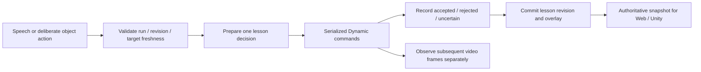

# ImmerseTheBay improvement design plan

2026-11-14 · Design only · Baseline: main `1b61f3d`.

This plan consolidates parallel reviews of backend state, Web experience, and video/gesture grounding. It proposes work; it does not claim the improvements below are implemented. Existing implementation and verification: [handoff](HANDOFF-web-dynamic.md).

## 1. Product outcome and constraints

Deliver one reliable, simple experience: enter the convenience store → see actual live Dynamic video → speak or point at a product → insert a relevant short interaction → gradually return to the pending lesson checkpoint. Users must be able to change their mind during an interaction.

Keep the landscape stage, dim starting image, feathered central FOV, small subtitle area, and minimal controls. The background is context; it must never be mistaken for live video. Keep Dynamic as the video model and the existing server-side Luna/no-reasoning and transcription configuration. Do not silently switch to Stable or an older language model. API keys stay in ignored server configuration.

Web is the acceptance environment first. Glasses follow the same semantic contracts, but retain native resolution. No claim of physical 3D contact or distance from a 2D video. No new database, queue service, model family, package dependency or generalized agent framework is required for P0; evaluate additions only against a measured need.

## 2. Baseline: evidence and gaps

| Area | Existing evidence | Gap that matters |
|---|---|---|
| Video | Real Dynamic picture/audio, prompt acknowledgments and continuing chunks | Entire live bottle-point → visible change → rejoin sequence still unverified; capacity 429s and browser-tab loss interrupted attempts |
| Capacity handling | Four attempts/90-second budget; cancellation, cooldown and duplicate-session guards tested | Provider capacity cannot be guaranteed; distinguish waiting, connected, first frame and disconnect confirmation |
| Speech | Real Chrome recorder + synthetic microphone audio + real transcription + detour passed | User microphone/noise/echo coverage; no upstream cancellation/admission limits for uploads |
| DAG | Generated bento-heating branch and saved-checkpoint rejoin passed | Lost-response replay can double-advance a detour; new intents during a detour are rejected; return is abrupt |
| Pointing | One cropped bottle success; negative person/wall cases | Repeated small-bottle misses; no frame freshness, instance identity or tracking; inspect immediately starts a branch |
| Unity | Compile, contract checks, APK build | No device validation; current Point targets real meshes and has no video-coordinate projection |

Single latency samples (about 1.3 seconds after recording Stop, 2.8 seconds for one plan, 3.6 seconds for one pointing flow) are observations, not p95 benchmarks. Existing 61 tests do not establish end-to-end visual success.

## 3. Critical code findings

1. `portal/agent/service.js` commits progress before the client receives the response. Without request IDs/revisions, a lost main-line response leads to cursor conflict; a repeated detour request can advance again because its main cursor stays constant.
2. `portal/public/learn.js` can report live/ready based on command or chunk events before actual playback is verified. Track receipt is also insufficient proof of a rendered frame.
3. Joining an existing session currently resets the shared model and agent. `/sync` provides session information but no authoritative lesson snapshot for a late joiner.
4. `scene-point.js` checks run/beat/node changes but not frame age or scene motion. Its live path can fall back to the starting photo when the video has no dimensions. Detection becomes a generic noun in a free-text intent, losing which bottle was selected.
5. `flow.js` template matching can replace a richer goal with a generic shopping interaction. Active detours reject replacement/cancellation, and cues can imply selection or basket placement when the user only wanted to inspect.
6. `transcribe.js` bounds upload size but lacks service-wide admission and cancellation propagation. Decision logs contain transcripts and cumulative graph data without comprehensive stage timings.

## 4. User experience design

### Visible state, not inference

Use a small, persistent scene-status strip. Keep technical logs in the developer drawer.

| State | What the user sees | Allowed actions |
|---|---|---|
| Ready to start | Starting image; “尚未生成视频” | Start, lesson/image settings |
| Waiting for capacity | Image; countdown, attempt number, cancel | Cancel; explicitly choose static practice |
| Connecting / waiting for first frame | Image; “正在连接 / 等待第一帧” | Cancel |
| Live | Only after decoded frames and advancing playback are observed | Speak, inspect, lesson controls |
| Stalled | “视频暂停更新”; preserve current line | Retry connection/reconcile, Leave; no claim of live action |
| Disconnected / cleanup uncertain | Clear stopped or unconfirmed status | Recover or inspect session; do not blindly create another billed session |

Static practice must remain explicitly labeled. Never start it silently after live failure. Distinguish mute/autoplay, absent media, 429 capacity, network failure and permission denial.

### Main controls

Keep one microphone button with states: Speak → recording → Stop → transcribing. Keep the existing practice/guide-purpose selector until mixed-intent routing is validated; a bad Japanese attempt must not be mistaken for a new shopping goal. Surface a short editable transcript only when ambiguity requires correction.

Pointing initially highlights and labels an object. **Inspect is not purchase or selection.** A deliberate select gesture or “use this object” action commits the interaction. Offer a small “回到主线” action during detours, with a brief transition rather than a hard reset. Display current shopping objective and temporary action without exposing a graph editor.

Prioritize gesture input: overlay UI → active object selection → lesson navigation. One pinch must never both select a bottle and advance the lesson. Keep controls and target lines within the central FOV; peripheral regions carry context only.

## 5. State and command design

Maintain separate transport/media, lesson, and input states; avoid expanding the current collection of boolean flags without an explicit transition model.

### Recoverable operations

Add a versioned operation envelope: `runId`, `requestId`, `expectedRevision`, `lessonVersion`, and optional `targetRef`. Preserve current response fields for compatibility. Cache bounded decisions keyed by run/request ID; a replay returns the same operation and must not invoke another model or create another DAG transition. Reject conflicting reuse of an ID.

Expose an authorized snapshot containing committed main cursor, active detour, pending operation and revision. Add command receipts/commit semantics: a prepared decision does not silently become a completed interaction before the driver reports the command outcome. If no scene command is required, commit directly.

Do not claim exactly-once execution at Reactor: the current integration does not establish provider idempotency. If a command may have been accepted but its response is lost, mark the operation uncertain, reconcile available state, and avoid automatic replay. Never treat `prompt_accepted` as proof the requested visual action happened.

Reset creates a new run and invalidates old operations. Leave cancels pending work. Bound cached operations and snapshots. After restart, recover lesson state independently of the video connection; do not silently resurrect a paid session. Begin with atomic, versioned local snapshots suitable for the existing single-process deployment. Revisit storage only if multi-instance operation becomes a requirement.

### Shared-session ownership

A late joiner reads the current snapshot and mirrors the scene without reset. Only one active driver emits commands. Use an explicit server-owned driver lease and a visible take-control action; disconnect/expiry behavior must be tested. Distinguish “Join” from “Restart lesson for everyone.” Unity protocol adoption is required before enabling shared v2 driving across both clients.

## 6. Dynamic intent and gradual rejoin

Represent temporary interactions as forward visits with a saved semantic checkpoint, not only a numeric line index. Store the user's requested action, relevant object, pending learning objective and allowed return point.

Example: ask where rice balls are → inspect a bottle → ask its price → decide not to take it → clerk redirects attention to rice balls → original pending line. Do not insert a purchase or basket action unless requested.

Use deterministic plans only for positively matched supported actions. Negation, comparison, heating, cancellation and compound intents need semantic routing or a short clarification. Each generated plan contains learner-role lines, consistent translations, continuity-preserving cues, and an explicit return transition.

During a detour support continue, cancel and replace. Replacement supersedes future nodes and appends fresh visits; it does not create an unbounded stack or rewind an executed node. Coalesce rapid changes to the latest deliberate intent. Define which action wins when cancel and commit race using the expected revision. Preserve bounded interaction lengths, but replace the opaque six-detour cutoff with a visible, configurable session policy.

### Character continuity and prompt composition

**Requirement added by the user:** the same clerk must retain the same face throughout opening, main beats, detours, cancellation, replacement and rejoin. Preserve facial structure, apparent age, skin tone, hairstyle, clothing and accessories from the approved starting image; expression, gaze, speech and natural pose may change. Do not invent demographic descriptions or facial details missing from the reference. If the clerk leaves the frame, their return must retain the same identity. Preserve the established voice where audio steering supports it, without claiming a voice-lock API exists.

Build each visual prompt from a server-owned continuity anchor plus exactly one current action. The planner proposes the action; it cannot overwrite the character anchor. Apply composition **after** optional LLM refinement to every outgoing `set_prompt`, including deterministic fallback, pointing, branch and return paths. Reserve room for the anchor inside the existing three-sentence / 95-word / 600-character limits; shorten the action first, never silently truncate away identity. Reject conflicting action cues such as replacing the clerk or changing their face. Keep audio instructions in `set_audio_prompt`.

Proposed compact visual template (not yet wired into runtime):

> Keep the same clerk from the starting image, with unchanged facial features, age, skin tone, hairstyle, clothing and accessories. The clerk gently indicates the selected bottle while maintaining a natural expression. Continue the same store, lighting and viewpoint without a cut or character replacement.

Replace only the second sentence for each physical delta; use the grounded target description when available. Rejoin example: “The same clerk gently redirects attention toward the original checkout task.” Avoid re-describing an entire new shop or adding new people on each turn. Keep the original image as the identity reference for the run; do not repeatedly call `set_image` or reset the video merely to restate identity. If the reference has no visible clerk, explicitly mark identity as unanchored until an operator-approved clear generated frame is available; do not pretend a detailed face was grounded in the original image.

Prompt constraints improve steering but do not guarantee face preservation. Evaluate bounded video sequences at opening, side view, brief occlusion, detour, cancellation and rejoin. Review visible facial features, hair and clothing together; do not infer identity success from command acknowledgments. Record drift separately from target-action success. If drift is observed, flag the result and test a continuity-only correction without advancing the lesson; do not silently reseed/reset the scene. Reference-frame control beyond the existing starting-image API requires capability verification before design commitments.

### Context management: structured state instead of growing history

The server owns a bounded `SceneContext` with explicit provenance and lifecycle. This is a proposed v2 contract, not a new field accepted by the existing endpoint today.

| Layer | Contents | Lifetime / update rule |
|---|---|---|
| Identity anchor | `characterId`, approved reference asset/version, grounded appearance, fixed continuity instructions | Immutable within a run; new reference requires an explicit new run |
| Scene anchor | Store/layout, style, lighting, viewpoint, original learning objective | Stable baseline; only an authorized scene transition changes it |
| Committed state | Run/revision, main checkpoint, active node, confirmed object actions, accepted command and visual-observation status | Updated through operation commit; command acceptance does not prove visual completion |
| Current goal | Latest explicit intent, action type, selected `targetRef`, cancel/replace semantics | Replaces superseded goals; must not overwrite the saved main checkpoint |
| Detour memory | Saved return objective, completed visits, current branch, next permitted transition | Bounded active branch; archive completed/canceled branches outside the model input |
| Ephemeral evidence | Transcript, live-frame reference, grounded bounds, gesture and timestamp | Expire on time limit, revision/run change, invalid transform, cancellation or tracking loss |
| Recent context | Up to three relevant committed action summaries, unresolved question and response | Bounded facts only; no complete transcripts, repeated prompts or cumulative DAG dump |

Construct model inputs through one allowlisted context builder shared by planning and refinement. Select fields by operation: navigation uses deterministic state; planning receives current intent/target and return objective; refinement receives current line, transcript and compact scene anchors. Do not send raw frame bytes to text-only planning, the entire lesson, all prior branch nodes, or unrelated room observations. Measure serialized input size and provider token usage; begin with a configurable 2,000-token context target (excluding system instructions and image input), then tune from latency/quality evidence. Never truncate JSON or discard identity, current intent, revision or return anchor to meet the budget: remove old summaries first, then reject or reduce optional input explicitly.

Resolve conflicts by field ownership: fixed identity and scene constraints come from trusted run configuration; the latest deliberate user goal controls the requested action; only current grounded evidence supplies object descriptors; the committed checkpoint controls rejoin. A stale summary never wins over a newer revision. Treat captions, transcripts, model observations and summaries as data, not system instructions. A user saying “take that bottle” changes the action, not the clerk's identity. A canceled purchase must not survive as an active objective in subsequent prompts.

Derive compact memory from validated committed events wherever possible; do not add an LLM summarization call to every turn. Store attempted, accepted, visually observed and user-confirmed actions distinctly. Preserve unresolved ambiguity rather than summarizing a guess as fact. Reconnect restores the same anchor/version and committed checkpoint; reset discards run-local goals, evidence and summaries. Log context version, selected field names, byte/token counts and expiration reasons with the operation ID; avoid logging full transcripts or image payloads by default.

Acceptance additions:
- All visual prompt paths preserve the continuity anchor within length limits, including maximum-length model output and provider-failure fallback; audio prompts remain sound-only.
- A branch, replacement, cancel, reconnect and rejoin preserve the character reference and original main objective; reset creates an explicit new context.
- Stale frames, superseded goals and canceled purchase actions never leak into the next prompt; ambiguous evidence stays unresolved.
- Long-session replay keeps model input bounded without dropping identity/current goal/return checkpoint; report token counts and latency before/after.
- Human review of live clips checks face continuity across visible transitions; hidden or blurred faces are marked unassessable rather than passed. Prompt text tests alone cannot satisfy this acceptance gate.

## 7. Video-object and gesture design

### Frame-bound target references

Attach source kind (`live` or explicit `practice`), session/run, scene revision, capture timestamp, media time, source dimensions, crop transform and pointer coordinates to grounding. A live interaction must fail clearly if no usable live frame exists; it must not silently analyze the starting photo.

Return an object instance reference with canonical category, bounds, source frame, and supported appearance/location descriptors. Pass this reference into the planner rather than discarding it into “the bottle.” Use only grounded descriptors; do not infer ingredients, stock or product identity from generic packaging.

Keep the successful local-crop approach, including edge clamping and inverse coordinate mapping. Enlargement cannot recover detail absent from the native frame. Low confidence or ambiguity should ask the user to aim again or select a candidate, not invent a target. Confidence thresholds must be evaluated on annotated examples, not treated as calibrated probabilities.

### Freshness and tracking

P0 rejects results from replaced runs/scenes, invalid geometry, frozen/missing live frames, and stale input. Also invalidate observations on display resize/recenter, texture transform changes and tracking loss. Frame-age limits must account for measured inference latency; select the initial bound from baselines rather than rejecting every legitimate 1–3 second response.

P1 adds short-lived local tracking between sparse model detections. Invalidate on occlusion, scene cuts, large motion, uncertain association or target expiry. Re-ground at selection time if necessary. Do not send every video frame to the LLM. Choose a tracker only after comparing a minimal dependency-free baseline with candidate libraries; new dependencies remain a review item.

Define 2D relations separately: pointing at, entering a target region, dwelling near, and selecting. Hysteresis, dwell and cooldown prevent repeated triggers. “Approaching” means decreasing projected distance to a tracked image region unless a separate calibrated 3D measurement exists.

### Glasses projection

Project a calibrated hand ray onto the Visko screen plane, map the hit to video UV, then apply the same crop/FOV transforms as Web. Keep real-world mesh hits in a separate namespace from video targets. The current palm-forward approximation is not measured index direction. Calibrate ray alignment, handedness, mirrored/flipped texture coordinates and hit tolerance on S25 + Air 2 Ultra. Resolve existing Next/Hint pinch mappings before enabling object selection.

## 8. Speech, latency and capacity

Keep recorded-turn transcription as the first reliable path. Add echo suppression/scene-audio ducking with restoration, visible input level, cancellation, and clear no-speech handling. Do not add a streaming speech architecture until measurements show the recorded path cannot meet the interaction target.

Add global/per-client upload and model-call admission before allocating large buffers; propagate cancellation to upstream requests where supported. Use bounded queues and return actionable Retry-After without logging audio or credentials. Limit duplicate vision/STT work while another action is pending.

Avoid model calls for ordinary navigation and unchanged scene prompts. Use compact schemas for optional language feedback; give optional refinement its own deadline so deterministic feedback can appear promptly. Preserve per-session prompt pacing. Prioritize cancellation and the latest deliberate goal over stale queued work.

Keep the existing Dynamic retry policy as a baseline. Test delayed connect completion, cleanup failure, leaving during connection, multiple tabs and manual retry. Cross-tab coordination can prevent duplicate sessions; a server admission gate is a later option if per-page cooldown is demonstrably insufficient. Do not promise capacity or silently change models.

## 9. Acceptance and measurement

Instrument one correlation chain: input → upload → transcript → grounding → intent plan → command sent → acknowledgment → first subsequent frames → committed/rejoined lesson. Record timings, model, request/run/revision, failure class and media counters. Keep full audio/images off by default; use opt-in, bounded test artifacts and configurable transcript retention.

Proposed targets below are acceptance goals to calibrate against a baseline, not current performance claims:

| Test | Required evidence / target |
|---|---|
| Layout and comprehension | 1280×720 and 1440×900 without scrolling; central controls remain legible; observed users distinguish live/static/waiting/recording within five seconds target |
| UI feedback | Local action acknowledgment within 100 ms target; cancel responds promptly without another queued request |
| Retry/replay | Dropped response, duplicate request, double-click and cancel/reset races never create a second logical transition |
| Speech | Real browser + actual microphone tests in quiet and store-audio conditions; distinguish model errors from permission/network errors |
| Latency | Report p50/p95 by stage over at least 20 representative recorded cases; initial targets: transcript-to-plan p95 ≤3 s and point-to-command-ack p95 ≤5 s, excluding capacity queue wait |
| Media state | No “Live” before actual playback; stalled/ended media is labeled; canceled/failed starts do not leave an untracked session |
| Coordinate mapping | Synthetic aspect-ratio, crop-edge, flip/mirror and resize cases; inverse mapping error target ≤1 source pixel; stale transforms reject |
| Grounding | Annotated positives across sizes/positions, multiple similar bottles, moving frames and negatives. Report misses and wrong-object selections separately; no committed action on person/blank/unsupported control cases |
| DAG semantics | Chinese/Japanese/English: inspect, select, compare, negate, cancel, replace and gradual rejoin; preserve learner role and original pending objective |
| Visual adoption | Save bounded before/after video evidence with timestamps and prompt receipts; human checks the requested action. Missing provider applied-prompt telemetry remains explicitly unknown |
| Live end-to-end | At least 5 successful bounded runs covering bottle inspection, bottle selection, speech detour, cancellation/replacement and rejoin; record 429/no-capacity separately from application failures |
| Unity | Compile + contract checks, followed by actual S25/Air 2 Ultra calibration, gesture arbitration, mic/camera lifecycle and session cleanup tests |

Each paid live test remains under two minutes and ends with Leave. Keep recording/capture under the test operator's control. A run blocked before capacity is available does not count as a successful visual test. Use replayable, redistributable frame/gesture traces to work while capacity is unavailable.

## 10. Parallel execution plan

The coordinator owns integration, cross-module contracts, `portal/server.js`, package/check wiring, scene builder and shared docs. Use three worker slots plus the coordinator; more chats do not remove the need to serialize shared-file changes. Reuse current worktrees where appropriate, starting new task branches from current main. Do not merge old pre-LFS branches.

| Workstream | Ownership | Initial deliverable | Depends on |
|---|---|---|---|
| A — State and DAG | `portal/agent/**`, agreed new state helpers | Idempotent operation/revision/snapshot contract and fault-injection tests | Coordinator contract freeze |
| B — Web experience | `portal/public/learn*`, dedicated input/media modules | Actual-media state UI, recoverable operations, inspect/select/cancel UX | A envelope; C target contract |
| C — Vision and evaluation | `portal/vision/**`, `scene-point.js`, dedicated fixtures | Frame identity/ROI/instance grounding, freshness checks and annotated tests | Coordinator coordinate/event contract |
| D — Unity learning | `Assets/Scripts/Learning/**` | Snapshot/revision client, hand-to-video projection, gesture arbitration | A/C contracts and Web acceptance |
| E — Device/media lifecycle | `Assets/Scripts/Visko/**`, `Assets/Plugins/Android/**` | Device transport, speech/camera cleanup and diagnostics | D interface; coordinator device/build window |

B must not edit `scene-point.js` while C owns it. A owns the new transcription limits; a separate worker may take a clearly assigned file subset only after the contract is stable. Content changes remain under the content owner; coordinator requests new branch/cancel/rejoin fixtures explicitly. Every worker reports files, evidence, limitations and integration requests.

### Wave 0 — Baseline and contract freeze

Create reproducible live/recorded test fixtures; define state vocabulary, operation IDs, target reference, driver ownership, SceneContext ownership/lifetimes, character reference and acceptance artifact format. Capture the currently missing live bottle sequence if capacity permits. Freeze v2 contracts before parallel edits.

### Wave 1 — P0 correctness, three parallel workers

A: recovery/replay protocol, explicit pending-operation cancellation, bounded context builder and final visual-prompt continuity composition. B: truthful media states and client operation lifecycle. C: frame identity and grounded target references. Coordinator integrates and runs lost-response, stale-frame, shared-join and cancellation tests. Do not expand features until duplicate-transition and photo/live ambiguity failures are eliminated.

### Wave 2 — P1 fluid interaction

A: intent fidelity, cancel/replace, gradual rejoin, bounded speech requests and persistence. B: speech UX, inspection/selection and recovery UI. C: target association, short-lived tracking and semantic/visual evaluation, including face-continuity clips with no identity claims from unassessable frames. Tune latency only after stage measurements exist. Complete the five live end-to-end cases.

### Wave 3 — Device transfer

D and E adopt the accepted contracts and calibrate on hardware; coordinator owns Unity scene regeneration, compile and APK builds. A/B/C workers handle diagnosed issues without simultaneous edits to device-owned paths. Device-ready is a separate milestone from Web-ready.

### P2, only after P0/P1 acceptance

Consider continuous hands-free speech, streaming transcription, richer object tracking, adaptive learning/scoring and multi-instance deployment. Each requires evidence of user benefit and a measured latency/accuracy/cost baseline. Avoid growing the visible interface or adding a new infrastructure layer just to enable parallel development.

## 11. Release and handoff rules

Each wave uses small reviewable commits and focused tests. Preserve compatibility or explicitly gate v2 behavior until both driving clients support it. Merge into main only after integrated acceptance; hardware claims require hardware evidence. Keep a stable demo path, updated handoff, known limitations, and a reproducible test report. Roll back the affected feature path without silently changing the requested video model.

The immediate implementation order is: **state correctness + truthful playback → reliable object reference → deliberate action + cancel/rejoin → live visual proof → glasses calibration**.
